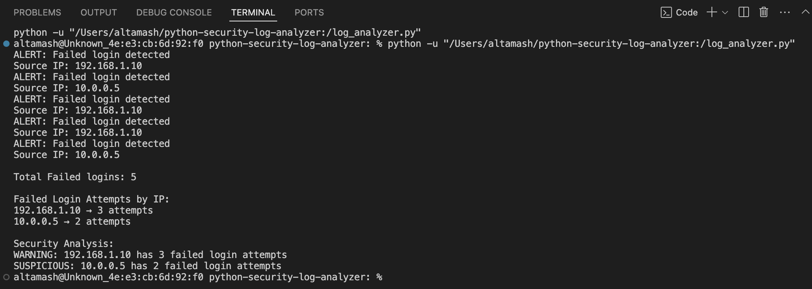

# Python Security Log Analyzer

A Python-based defensive security project that analyzes authentication logs, detects failed login attempts, tracks activity by source IP address, and generates threshold-based alerts.

## Project Overview

Authentication logs can contain repeated login failures that warrant investigation. Reviewing these events manually can be time-consuming.

This project automates basic log analysis by reading a sample log file, identifying failed-login events, extracting source IP addresses, counting attempts, and classifying activity according to configurable rules.

## Objectives

- Read authentication logs from a text file.
- Detect failed login events.
- Extract source IP addresses.
- Count failed attempts by IP address.
- Generate alerts based on attempt counts.
- Handle a missing log file gracefully.

## Features

- Line-by-line log processing
- Failed-login event detection
- Source IP extraction
- Dictionary-based attempt counting
- Threshold-based alert classification
- Basic file error handling
- Structured output in the terminal

## Technologies Used

- Python 3
- File handling
- Strings and string methods
- Dictionaries and lists
- Functions and return values
- Conditional statements and loops
- Exception handling

## Project Structure

```text
python-security-log-analyzer/
├── log_analyzer.py
├── security_log.txt
├── README.md
└── screenshots/
    └── log-analyzer-output.png
```

## How It Works

1. The program opens the supplied authentication log.
2. It reads the file line by line.
3. It identifies lines containing failed-login events.
4. It extracts the source IP address.
5. It counts total failures and failures per IP.
6. It compares each IP's count with the project's threshold.
7. It prints a summary and security classifications.

## Example Log Entries

```text
Failed login from 192.168.1.10
Successful login from 192.168.1.20
Failed login from 10.0.0.5
Failed login from 192.168.1.10
Failed login from 192.168.1.10
Failed login from 10.0.0.5
```

## Example Output

```text
Total Failed logins: 5

Failed Login Attempts by IP:
192.168.1.10 → 3 attempts
10.0.0.5 → 2 attempts

Security Analysis:
WARNING: 192.168.1.10 has 3 failed login attempts
SUSPICIOUS: 10.0.0.5 has 2 failed login attempts
```

The output above illustrates the expected result for the sample log and a threshold of three.

## Alert Logic

- Three or more failed attempts: WARNING
- Two failed attempts: SUSPICIOUS
- One failed attempt: INFO

These are demonstration rules defined by this project, not universal security standards. Repeated failures alone do not establish that an attack occurred.

## Error Handling

The analyzer handles a missing log file by displaying an error message instead of allowing an unhandled `FileNotFoundError` to terminate the program.

## Limitations

- Uses a small, predefined sample log format.
- Extracts IP addresses based on the expected text pattern.
- Uses simple thresholds rather than statistical anomaly detection.
- Does not automatically block IP addresses or investigate an actual incident.

## Future Improvements

- Support additional log formats.
- Validate extracted IP addresses.
- Accept configurable thresholds.
- Export results to JSON or CSV.
- Add automated unit tests.

## What I Learned

- Reading files line by line
- Filtering events with conditional statements
- Extracting data from strings
- Counting repeated values with dictionaries
- Organizing code into reusable functions
- Handling file errors
- Applying simple security rules to authentication logs

## Responsible Use

This project is an educational defensive-security tool intended for sample logs or logs you are authorized to analyze.

## Example Output

